<!-- Generated by scripts/render-svgs.mjs — edit the data there, not this file. The Writing block is refreshed hourly by scripts/render-writing.mjs. -->

<a href="https://mehmettalhairmak.me"><picture><source media="(prefers-color-scheme: dark)" srcset="assets/hero-dark.svg"></picture></a>

<a href="https://mehmettalhairmak.me"><picture><source media="(prefers-color-scheme: dark)" srcset="assets/chip/site-dark.svg"></picture></a>
<a href="https://linkedin.com/in/mehmettalhairmak"><picture><source media="(prefers-color-scheme: dark)" srcset="assets/chip/linkedin-dark.svg"></picture></a>
<a href="https://medium.com/@mehmetirmaakk"><picture><source media="(prefers-color-scheme: dark)" srcset="assets/chip/medium-dark.svg"></picture></a>
<a href="mailto:mtalhairmak@gmail.com"><picture><source media="(prefers-color-scheme: dark)" srcset="assets/chip/email-dark.svg"></picture></a>

<picture><source media="(prefers-color-scheme: dark)" srcset="assets/section/work-dark.svg"></picture>

<a href="https://mehmettalhairmak.me/work/dotquit"><picture><source media="(prefers-color-scheme: dark)" srcset="assets/work/dotquit-dark.svg"></picture></a>
<a href="https://mehmettalhairmak.me/work/snapshade"><picture><source media="(prefers-color-scheme: dark)" srcset="assets/work/snapshade-dark.svg"></picture></a>
<a href="https://mehmettalhairmak.me/work/bananaultra"><picture><source media="(prefers-color-scheme: dark)" srcset="assets/work/bananaultra-dark.svg"></picture></a>
<a href="https://mehmettalhairmak.me/work/yuksi"><picture><source media="(prefers-color-scheme: dark)" srcset="assets/work/yuksi-dark.svg"></picture></a>
<a href="https://mehmettalhairmak.me/work/8thsense"><picture><source media="(prefers-color-scheme: dark)" srcset="assets/work/8thsense-dark.svg"></picture></a>
<a href="https://mehmettalhairmak.me/work/buscalia"><picture><source media="(prefers-color-scheme: dark)" srcset="assets/work/buscalia-dark.svg"></picture></a>
<a href="https://mehmettalhairmak.me/work/depremyardim"><picture><source media="(prefers-color-scheme: dark)" srcset="assets/work/depremyardim-dark.svg"></picture></a>

<picture><source media="(prefers-color-scheme: dark)" srcset="assets/section/systems-dark.svg"></picture>

<a href="https://github.com/nodemt/social-engine-nest"><picture><source media="(prefers-color-scheme: dark)" srcset="assets/systems/social-engine-nest-dark.svg"></picture></a>
<a href="https://github.com/nodemt/realtime-messaging-api-node"><picture><source media="(prefers-color-scheme: dark)" srcset="assets/systems/realtime-messaging-api-node-dark.svg"></picture></a>
<a href="https://github.com/nodemt/rss-aggregator-go"><picture><source media="(prefers-color-scheme: dark)" srcset="assets/systems/rss-aggregator-go-dark.svg"></picture></a>
<a href="https://github.com/nodemt/nestjs-media-guard"><picture><source media="(prefers-color-scheme: dark)" srcset="assets/systems/nestjs-media-guard-dark.svg"></picture></a>

<picture><source media="(prefers-color-scheme: dark)" srcset="assets/section/approach-dark.svg"></picture>

<picture><source media="(prefers-color-scheme: dark)" srcset="assets/fig-request-path-dark.svg"></picture>

<a href="https://mehmettalhairmak.me/work/bananaultra/edge"><picture><source media="(prefers-color-scheme: dark)" srcset="assets/principles/1-dark.svg"></picture></a>
<a href="https://mehmettalhairmak.me/work/social-engine/queue"><picture><source media="(prefers-color-scheme: dark)" srcset="assets/principles/2-dark.svg"></picture></a>
<a href="https://mehmettalhairmak.me/work/yuksi/mq"><picture><source media="(prefers-color-scheme: dark)" srcset="assets/principles/3-dark.svg"></picture></a>
<a href="https://mehmettalhairmak.me/work/8thsense"><picture><source media="(prefers-color-scheme: dark)" srcset="assets/principles/4-dark.svg"></picture></a>
<a href="https://mehmettalhairmak.me/work/8thsense"><picture><source media="(prefers-color-scheme: dark)" srcset="assets/principles/5-dark.svg"></picture></a>
<a href="https://mehmettalhairmak.me/work/bananaultra/r2"><picture><source media="(prefers-color-scheme: dark)" srcset="assets/principles/6-dark.svg"></picture></a>

<picture><source media="(prefers-color-scheme: dark)" srcset="assets/section/writing-dark.svg"></picture>

<!-- WRITING:START -->

<a href="https://medium.com/@mehmetirmaakk/nestjs-typeorm-vs-drizzle-orm-eda7d78b945b"><picture><source media="(prefers-color-scheme: dark)" srcset="assets/writing/1-dark.svg"></picture></a>
<a href="https://medium.com/@mehmetirmaakk/beyond-the-boilerplate-why-nestjs-is-the-unsung-hero-of-scalable-cloud-backends-in-2026-956c30a6a865"><picture><source media="(prefers-color-scheme: dark)" srcset="assets/writing/2-dark.svg"></picture></a>
<a href="https://medium.com/@mehmetirmaakk/post-quantum-cryptography-go-nodejs-python-2026-7498f8cd8b2b"><picture><source media="(prefers-color-scheme: dark)" srcset="assets/writing/3-dark.svg"></picture></a>
<a href="https://medium.com/@mehmetirmaakk/building-and-automating-production-ready-cloud-architecture-go-gcp-and-terraform-a0e6938caa49"><picture><source media="(prefers-color-scheme: dark)" srcset="assets/writing/4-dark.svg"></picture></a>
<a href="https://medium.com/@mehmetirmaakk/stop-letting-users-spy-on-each-other-%EF%B8%8F-%EF%B8%8F-building-a-smart-media-guard-in-nestjs-9d7640bd4b98"><picture><source media="(prefers-color-scheme: dark)" srcset="assets/writing/5-dark.svg"></picture></a>

<!-- WRITING:END -->

<a href="https://medium.com/@mehmetirmaakk"><picture><source media="(prefers-color-scheme: dark)" srcset="assets/chip/articles-dark.svg"></picture></a>

<picture><source media="(prefers-color-scheme: dark)" srcset="assets/section/bom-dark.svg"></picture>

<picture><source media="(prefers-color-scheme: dark)" srcset="assets/bom-dark.svg"></picture>

<a href="https://mehmettalhairmak.me"><picture><source media="(prefers-color-scheme: dark)" srcset="assets/footer-dark.svg"></picture></a>

