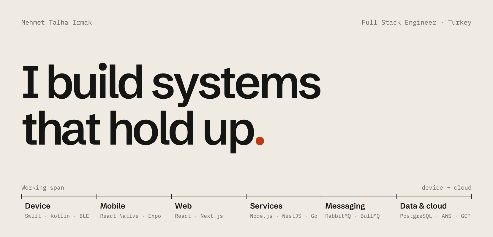

<a href="https://mehmettalhairmak.me">
  <picture>
    <source media="(prefers-color-scheme: dark)" srcset="assets/header-dark.png">
    
  </picture>
</a>

Self-taught, TypeScript-focused full-stack engineer. For 4+ years I've shipped production apps end to end — React Native and Next.js interfaces on top of event-driven cloud backends in Node.js, NestJS and Go. Currently Full Stack Software Developer at [Neon Apps](https://neonapps.co), Istanbul.

**[mehmettalhairmak.me](https://mehmettalhairmak.me)** · [LinkedIn](https://linkedin.com/in/mehmettalhairmak) · [Medium](https://medium.com/@mehmetirmaakk) · [mtalhairmak@gmail.com](mailto:mtalhairmak@gmail.com)

## `01` Selected work

| | Project | | Period |
|---|---|---|---|
| `01` | **[DotQuit](https://mehmettalhairmak.me/work/dotquit)** | Native macOS utility that quits apps when their last window closes. | <code>Oct&nbsp;2026</code> |
| `02` | **[SnapShade](https://mehmettalhairmak.me/work/snapshade)** ↳`03` | AI hairstyle transformation app on the BananaUltra architecture, narrowed to a single concept. | <code>Mar&nbsp;2026&nbsp;·&nbsp;Archived</code> |
| `03` | **[BananaUltra](https://mehmettalhairmak.me/work/bananaultra)** ◆ | Generative AI image platform, launched and monetised independently. | <code>Dec&nbsp;2025&nbsp;·&nbsp;Archived</code> |
| `04` | **[Yuksi](https://mehmettalhairmak.me/work/yuksi)** ◆ | Uber-style on-demand logistics SaaS — mobile app, CRM and an event-driven backend. | <code>Dec&nbsp;2025&nbsp;–&nbsp;Feb&nbsp;2026</code> |
| `05` | **[8thSense](https://mehmettalhairmak.me/work/8thsense)** | Enterprise IoT platform — cloud infrastructure and a real-time telemetry charting engine. | <code>Jun&nbsp;2022&nbsp;–&nbsp;Jul&nbsp;2025</code> |
| `06` | **[Buscalia](https://mehmettalhairmak.me/work/buscalia)** | Real-time fleet monitoring dashboard for a Spanish logistics-tech startup. | <code>Oct&nbsp;–&nbsp;Nov&nbsp;2023</code> |
| `07` | **[depremyardim](https://mehmettalhairmak.me/work/depremyardim)** | Crisis platform for rescue requests after the 6 February 2023 earthquakes. | <code>Feb&nbsp;2023</code> |

◆ explorable architecture on the site · ↳ shares another project's architecture

## `02` Internal systems

| | System | | |
|---|---|---|---|
| <code>S1</code> | **Social Engine** ◆ | NestJS social backend that keeps HTTP responses under 50ms. | [Repo](https://github.com/nodemt/social-engine-nest) · [Explorer](https://mehmettalhairmak.me/work/social-engine) |
| <code>S2</code> | **Realtime Messaging API** | REST + Socket.IO messaging with presence, retries and scheduled messages. | [Repo](https://github.com/nodemt/realtime-messaging-api-node) · [Notes](https://mehmettalhairmak.me/work/messaging-api) |
| <code>S3</code> | **RSS Aggregator** | Concurrent Go scraper with a WebSocket push hub. | [Repo](https://github.com/nodemt/rss-aggregator-go) · [Notes](https://mehmettalhairmak.me/work/rss-aggregator) |
| <code>S4</code> | **Secure Media Guard** | NestJS microservice for authorised, multi-variant image delivery. | [Repo](https://github.com/nodemt/nestjs-media-guard) · [Notes](https://mehmettalhairmak.me/work/media-guard) |

## `03` Engineering approach

Principles are cheap. Each one here points to a system where it was tested in production.

- `§1` **Money and state change atomically, or not at all.** — [BananaUltra › Edge Functions](https://mehmettalhairmak.me/work/bananaultra/edge)
- `§2` **Keep slow work off the request path.** — [Social Engine › BullMQ](https://mehmettalhairmak.me/work/social-engine/queue)
- `§3` **Events over entanglement.** — [Yuksi › Event pipeline](https://mehmettalhairmak.me/work/yuksi/mq)
- `§4` **A frame budget is a real budget.** — [8thSense](https://mehmettalhairmak.me/work/8thsense)
- `§5` **Make the toolchain boring.** — [8thSense](https://mehmettalhairmak.me/work/8thsense)
- `§6` **Reduce friction, then reduce cost.** — [BananaUltra › Cloudflare R2](https://mehmettalhairmak.me/work/bananaultra/r2)

## `04` Writing

<!-- BLOG-POST-LIST:START -->
- `Sep 2026` · [NestJS Dünyasında Alışkanlıkları Kırmak: TypeORM’dan Drizzle ORM’a Geçiş Zamanı mı?](https://medium.com/@mehmetirmaakk/nestjs-typeorm-vs-drizzle-orm-eda7d78b945b)
- `Sep 2026` · [Beyond the Boilerplate: Why NestJS Is the Unsung Hero of Scalable Cloud Backends in 2026](https://medium.com/@mehmetirmaakk/beyond-the-boilerplate-why-nestjs-is-the-unsung-hero-of-scalable-cloud-backends-in-2026-956c30a6a865)
- `Jun 2026` · [Preparing for the Quantum Apocalypse: Post-Quantum Cryptography in Go 1.27, Node.js, and Python](https://medium.com/@mehmetirmaakk/post-quantum-cryptography-go-nodejs-python-2026-7498f8cd8b2b)
- `Jun 2026` · [Building and Automating Production-Ready Cloud Architecture: Go, GCP, and Terraform](https://medium.com/@mehmetirmaakk/building-and-automating-production-ready-cloud-architecture-go-gcp-and-terraform-a0e6938caa49)
- `Mar 2026` · [Stop Letting Users Spy on Each Other! Building a Smart Media Guard in NestJS](https://medium.com/@mehmetirmaakk/stop-letting-users-spy-on-each-other-%EF%B8%8F-%EF%B8%8F-building-a-smart-media-guard-in-nestjs-9d7640bd4b98)
<!-- BLOG-POST-LIST:END -->

[All articles on Medium ↗](https://medium.com/@mehmetirmaakk)

## `05` Bill of materials

| Layer | |
|---|---|
| <code>Languages</code> | TypeScript, JavaScript, Go, Python, Swift, Kotlin, SQL |
| <code>Mobile&nbsp;&amp;&nbsp;web</code> | React Native, Expo, EAS, React, Next.js, Zustand, Redux Toolkit, React Query, D3.js |
| <code>Services</code> | Node.js, Express, NestJS, Go (Gin), FastAPI |
| <code>Messaging</code> | RabbitMQ, BullMQ, WebSocket, Socket.IO, SQS, SNS |
| <code>Data</code> | PostgreSQL, MySQL, MongoDB, Redis, DynamoDB, ElasticSearch |
| <code>AWS</code> | **IaC & ops** CDK, CloudFormation, CloudWatch · **Compute** Lambda, EC2, Amplify · **APIs & auth** API Gateway, AppSync, Cognito · **Storage** S3, RDS, DynamoDB · **Messaging** SNS, SES |
| <code>Cloud</code> | Google Cloud Run, Terraform, Docker, Cloudflare R2 |
| <code>Platforms</code> | Supabase, Firebase, Appwrite, RevenueCat, Sentry, Mixpanel |

---

Full portfolio, architecture explorers and engineering notes at **[mehmettalhairmak.me](https://mehmettalhairmak.me)** — press ⌘K to jump anywhere.
